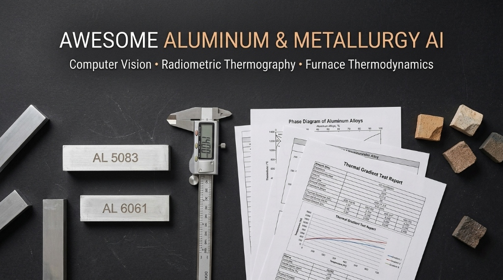
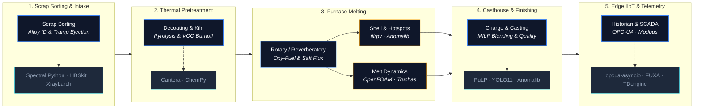

# Awesome Industrial Metallurgy AI 

  

  
  
  
  
  
  

---

A canonical, scientifically curated directory of computational metallurgy, radiometric infrared thermography engines, scrap sorting spectroscopy, combustion kinetics, refractory computer vision, and industrial IoT standards for **Secondary Aluminum Recycling, Pyrometallurgical Furnaces, and Smart Casthouse Engineering**.

---

## Contents

- [Architecture and Process Flow](#architecture-and-process-flow)
- [Scrap Characterization and Spectroscopic Sorting](#scrap-characterization-and-spectroscopic-sorting)
  - [Laser-Induced Breakdown Spectroscopy](#laser-induced-breakdown-spectroscopy)
  - [X-Ray Fluorescence and Transmission](#x-ray-fluorescence-and-transmission)
  - [Hyperspectral and Optical Sorting](#hyperspectral-and-optical-sorting)
- [Thermal Decoating, Delacquering and Pretreatment](#thermal-decoating-delacquering-and-pretreatment)
- [Furnace Pyrometallurgy and Combustion Kinetics](#furnace-pyrometallurgy-and-combustion-kinetics)
  - [Combustion Kinetics and Burner Dynamics](#combustion-kinetics-and-burner-dynamics)
  - [Salt Flux Thermodynamics and Dross Minimization](#salt-flux-thermodynamics-and-dross-minimization)
  - [Heat Transfer and Thermal Plant Balancing](#heat-transfer-and-thermal-plant-balancing)
- [Thermal Imaging, Radiometric Vision and Refractory Health](#thermal-imaging-radiometric-vision-and-refractory-health)
  - [Radiometric Sensor Arrays and Thermal Extraction](#radiometric-sensor-arrays-and-thermal-extraction)
  - [Refractory Degradation and Hotspot Monitoring](#refractory-degradation-and-hotspot-monitoring)
  - [Industrial Surface Defect and Anomaly Detection](#industrial-surface-defect-and-anomaly-detection)
- [Molten Bath Dynamics, Degassing and Casthouse CFD](#molten-bath-dynamics-degassing-and-casthouse-cfd)
- [Charge Optimization and Metallurgical Blending](#charge-optimization-and-metallurgical-blending)
- [Industrial IoT, SCADA Systems and Sensor Telemetry](#industrial-iot-scada-systems-and-sensor-telemetry)
  - [OPC-UA and Industrial Protocols](#opc-ua-and-industrial-protocols)
  - [SCADA Visualization and Time-Series Historians](#scada-visualization-and-time-series-historians)
- [Edge AI Acceleration and Industrial Vision Runtimes](#edge-ai-acceleration-and-industrial-vision-runtimes)
- [Benchmark Datasets and Defect Compendiums](#benchmark-datasets-and-defect-compendiums)
- [Scientific Literature and Foundational References](#scientific-literature-and-foundational-references)
  - [Foundational Handbooks and Textbooks](#foundational-handbooks-and-textbooks)
  - [Seminal Journal Publications](#seminal-journal-publications)
- [Industrial Hardware, Sensors and Instrumentation](#industrial-hardware-sensors-and-instrumentation)
- [Industry Standards, Specifications and Regulatory Codes](#industry-standards-specifications-and-regulatory-codes)
  - [Scrap Trade Specifications](#scrap-trade-specifications)
  - [Alloy Designations and Composition Limits](#alloy-designations-and-composition-limits)
  - [Thermography and Thermal Inspection Standards](#thermography-and-thermal-inspection-standards)
  - [Best Available Techniques Regulatory Codes](#best-available-techniques-regulatory-codes)
- [Interactive Simulators, Calculation Tools and Notebooks](#interactive-simulators-calculation-tools-and-notebooks)
- [Professional Societies, Journals and Conferences](#professional-societies-journals-and-conferences)
- [Related Awesome Lists](#related-awesome-lists)
- [Contributing](#contributing)
- [Code of Conduct](#code-of-conduct)
- [License](#license)

---

## Architecture and Process Flow

Secondary aluminum recycling and high-temperature casthouse operations require closed-loop deterministic engineering spanning scrap intake, automated sorting, combustion efficiency, refractory lining integrity, melt purification, and factory-floor telemetry:

---

## Scrap Characterization and Spectroscopic Sorting

Software libraries, spectral processing engines, and deep learning architectures for rapid elemental analysis, spectral deconvolution, and automated optical sorting of aluminum scrap fractions (distinguishing wrought alloy series 1xxx, 3xxx, 5xxx, 6xxx from cast alloys 3xx.x with high Si/Cu).

### Laser-Induced Breakdown Spectroscopy

- [**DLR-WR/libskit**](https://github.com/DLR-WR/libskit) - Software toolkit developed by the German Aerospace Center (DLR) for Laser-Induced Breakdown Spectroscopy (LIBS) processing and online elemental alloy classification.
- [**MKastek/simLIBS**](https://github.com/MKastek/simLIBS) - Python framework simulating LIBS emission spectra with direct NIST Atomic Spectra Database interfaces for calibration-free elemental quantification.
- [**kstenio/libssa**](https://github.com/kstenio/libssa) - Laser-Induced Breakdown Spectroscopy spectra analyzer featuring automated baseline correction, peak deconvolution, and multi-element profiling.
- [**aleponce4/libs-spectroscopy-workbench**](https://github.com/aleponce4/libs-spectroscopy-workbench) - Interactive workbench for LIBS spectral processing, baseline subtraction, NIST spectral line identification, and simulated acquisition.
- [**chcomin/pyPIPS**](https://github.com/chcomin/pyPIPS) - Python library for processing plasma spectroscopy data, extracting electron temperature ($T_e$) and electron density ($n_e$) from Stark broadening.
- [**derb12/pybaselines**](https://github.com/derb12/pybaselines) - Comprehensive baseline correction algorithms (AsLS, airPLS, SNIP, rolling ball) essential for preprocessing raw LIBS and Raman scrap spectra.

### X-Ray Fluorescence and Transmission

- [**xraypy/xraylarch**](https://github.com/xraypy/xraylarch) - Python analysis suite for X-ray Fluorescence (XRF) and absorption spectroscopy, essential for non-destructive scrap alloy chemistry and heavy metal tramp identification (Pb, Bi, Cd).
- [**Mobaia/PhySpec**](https://github.com/Mobaia/PhySpec) - Physics-guided augmentation and multi-scale Transformer network for low-resource spectroscopic analysis and quantitative XRF alloy composition.
- [**tomopy/tomopy**](https://github.com/tomopy/tomopy) - Open-source Python toolbox for synchrotron and industrial X-ray tomography data processing and 3D reconstruction, vital for non-destructive cast ingot internal porosity inspection.
- [**tschoonj/xraylib**](https://github.com/tschoonj/xraylib) - Core C/Python library for X-ray matter interaction cross sections, fluorescence yields, and photoionization probabilities.

### Hyperspectral and Optical Sorting

- [**spectralpython/spectral**](https://github.com/spectralpython/spectral) - Comprehensive Python package for hyperspectral and multispectral image processing, powering optical sorting lines to separate scrap fractions.
- [**Kongsea/DeepSpectroscopy**](https://github.com/Kongsea/DeepSpectroscopy) - Deep learning models and spectral pre-processing pipelines tailored for rapid elemental classification and quantitative spectral regression.
- [**cem-miller/pysptools**](https://github.com/cem-miller/pysptools) - Spectral Python Tools for endmember extraction, spectral unmixing, and abundance mapping in mineral and scrap sorting conveyors.
- [**zichengzichengzi/Scrap_Steel_Image_Dataset**](https://github.com/zichengzichengzi/Scrap_Steel_Image_Dataset) - Open-source annotated benchmark dataset for scrap metal grading, object detection, and hazardous foreign object classification on sorting belts.
- [**arthursn/transformation-diagrams**](https://github.com/arthursn/transformation-diagrams) - Computes time-temperature-transformation (TTT) and continuous cooling transformation (CCT) diagrams based on thermodynamic diffusion equations.

---

## Thermal Decoating, Delacquering and Pretreatment

Pre-melt processing technologies for post-consumer packaging (UBC - Used Beverage Cans), coated sheet, and profile turnings. Focuses on low-temperature pyrolysis (450–550°C), organic coating removal, volatile organic compound (VOC) destruction, and prevention of premature aluminum oxidation.

- [**Cantera/cantera**](https://github.com/Cantera/cantera) - Chemical kinetics suite for modeling thermal pyrolysis of polymer coatings, lacquer off-gas compositions, and regenerative thermal oxidizer (RTO) destruction efficiency.
- [**chempy/chempy**](https://github.com/chempy/chempy) - Python package for chemistry problem-solving, mass balances, chemical reaction equilibria, and thermo-gravimetric analysis (TGA) kinetic modeling.
- [**sandialabs/pyro**](https://github.com/sandialabs/pyro) - Pyrolysis and thermal decomposition simulation routines for organic coatings on metallic substrates under controlled atmospheres.

---

## Furnace Pyrometallurgy and Combustion Kinetics

Secondary melting furnaces—Tilting Rotary Furnaces (TRF) and Reverberatory furnaces—require rigorous modeling of fuel-oxy combustion, thermal efficiency, heat conduction across refractory layers, and salt flux phase equilibria.

### Combustion Kinetics and Burner Dynamics

- [**Cantera/cantera**](https://github.com/Cantera/cantera) - The premier open-source chemical kinetics, thermodynamics, and transport suite. Essential for oxy-fuel and air-fuel burner modeling, flame adiabatic temperature, and flue gas emissions.
- [**speth/ember**](https://github.com/speth/ember) - Quasi-one-dimensional solver for unsteady strained laminar flames, providing detailed insight into burner aerodynamics and flame stabilization.
- [**DENG-MIT/reactorch**](https://github.com/DENG-MIT/reactorch) - A differentiable reacting flow simulation package in PyTorch, enabling gradient-based optimization of burner kinetics and flame behavior.
- [**acuoci/OpenSMOKE**](https://github.com/acuoci/OpenSMOKE) - Numerical framework for reacting flows and complex chemical kinetics with support for large detailed reaction mechanisms.

### Salt Flux Thermodynamics and Dross Minimization

Equimolar NaCl-KCl salt systems with fluoride additions (CaF₂, Na₃AlF₆ cryolite, NaF) act as protective covers, strip tenacious oxide skins ($\gamma\text{-Al}_2\text{O}_3$), and facilitate metallic droplet coalescence:

- [**pycalphad/pycalphad**](https://github.com/pycalphad/pycalphad) - Computational thermodynamics for multicomponent phase equilibria. Models aluminum-salt flux systems (NaCl-KCl-CaF₂), dross formation, and solute partitioning during melting.
- [**sundmanbo/opencalphad**](https://github.com/sundmanbo/opencalphad) - Open-source thermodynamic software for calculation of multicomponent phase equilibria and thermodynamic properties using the CALPHAD method.
- [**PhasesResearchLab/ESPEI**](https://github.com/PhasesResearchLab/ESPEI) - Automated parameter estimation and Bayesian uncertainty quantification for thermodynamic model parameters in CALPHAD databases.
- [**dogusariturk/PhaseForge**](https://github.com/dogusariturk/PhaseForge) - High-throughput alloy phase diagram prediction integrating machine learning interatomic potentials (MLIPs), ATAT, and CALPHAD modeling.
- [**ORNL-CEES/thermochimica**](https://github.com/ORNL-CEES/thermochimica) - High-performance computational library for multi-component equilibrium thermodynamics designed for direct coupling into multiphysics simulations.
- [**materialsproject/pymatgen**](https://github.com/materialsproject/pymatgen) - Materials analysis package for generating phase diagrams, Pourbaix diagrams, and thermodynamic stability analyses of aluminum intermetallics.

### Heat Transfer and Thermal Plant Balancing

- [**CalebBell/ht**](https://github.com/CalebBell/ht) - Comprehensive heat transfer library covering radiation exchange between burner flames and molten metal baths, and multi-layer refractory shell conduction.
- [**CalebBell/thermo**](https://github.com/CalebBell/thermo) - Extensive thermodynamic property calculation engine for pure chemicals and industrial mixtures (viscosity, thermal conductivity, enthalpy, heat capacity).
- [**oemof/tespy**](https://github.com/oemof/tespy) - Thermal Energy System Simulator for mass and energy balances in thermal plants, recuperators, heat exchangers, and off-gas recovery loops.
- [**CoolProp/CoolProp**](https://github.com/CoolProp/CoolProp) - High-precision formulation of fluid and gaseous properties across wide temperature and pressure ranges, vital for furnace exhaust modeling.

---

## Thermal Imaging, Radiometric Vision and Refractory Health

Acquisition and processing of raw radiometric temperature matrices (degrees Celsius per pixel) from Long-Wave Infrared (LWIR) camera cores, pyrometers, and machine vision sensors for furnace shell hotspot monitoring, refractory insulation failure prediction (corundum growth, spalling, thermal cracking), and taphole stream thermal tracking.

### Radiometric Sensor Arrays and Thermal Extraction

- [**LJMUAstroecology/flirpy**](https://github.com/LJMUAstroecology/flirpy) - Python library to control FLIR camera cores and extract calibrated 2D radiometric temperature matrices (°C / pixel) from thermal images and video streams.
- [**SanNianYiSi/thermal_parser**](https://github.com/SanNianYiSi/thermal_parser) - Lightweight Python parser for extracting raw thermal sensor arrays, Planck constants, and temperature matrices from FLIR and DJI radiometric formats.
- [**groupgets/pylepton**](https://github.com/groupgets/pylepton) - Pure Python library for interfacing with FLIR Lepton LWIR microbolometer modules over SPI/I2C for low-cost embedded thermal monitoring.
- [**elerac/EasyPySpin**](https://github.com/elerac/EasyPySpin) - Clean OpenCV-like `cv2.VideoCapture` wrapper for FLIR Spinnaker SDK, enabling seamless capture of industrial high-speed thermal and machine vision cameras.
- [**klecknerlab/simple_pyspin**](https://github.com/klecknerlab/simple_pyspin) - Pythonic class-based wrapper for the FLIR PySpin library, simplifying exposure, trigger, and image acquisition controls in manufacturing environments.
- [**OpenThermal/libseek-thermal**](https://github.com/OpenThermal/libseek-thermal) - Open-source driver and SDK for Seek Thermal compact long-wave infrared camera cores, enabling custom embedded thermography setups.
- [**gtatters/Thermimage**](https://github.com/gtatters/Thermimage) - R package for reading radiometric thermal files, converting raw analog-to-digital sensor values to temperatures, and adjusting for atmospheric emissivity and distance.
- [**s-du/Thermogram**](https://github.com/s-du/Thermogram) - Advanced thermographic image viewer and converter for radiometric IR files, supporting multi-point temperature extraction and false-color palettes.

### Refractory Degradation and Hotspot Monitoring

- [**ESA-PhiLab/PyRawS**](https://github.com/ESA-PhiLab/PyRawS) - Algorithmic toolkit for thermal surface anomaly detection, radiance tracking, saturation handling, and high-temperature anomaly segmentation.
- [**jpaguerre/ThRend**](https://github.com/jpaguerre/ThRend) - Infrared rendering framework for simulating LWIR thermography, heat dissipation, and synthetic thermal camera views of hot industrial bodies.
- [**khornlund/severstal-steel-defect-detection**](https://github.com/khornlund/severstal-steel-defect-detection) - High-resolution defect segmentation models for continuous industrial metal inspection lines.

### Industrial Surface Defect and Anomaly Detection

- [**open-edge-platform/anomalib**](https://github.com/open-edge-platform/anomalib) - Intel's flagship industrial anomaly detection library. Benchmark algorithms (PatchCore, PaDiM, FastFlow, EfficientAD) for isolating structural anomalies in refractories and metal surfaces without large defect training sets.
- [**Charmve/Surface-Defect-Detection**](https://github.com/Charmve/Surface-Defect-Detection) - The premier global open-source catalog of surface defect datasets, deep learning architectures, and benchmark papers for industrial substrates.
- [**YeahHuang/Al_surface_defect_detection**](https://github.com/YeahHuang/Al_surface_defect_detection) - Top-ranking competition solution for aluminum surface defect detection (cracks, coating defects, inclusions, peeling, and scratches).
- [**facebookresearch/segment-anything**](https://github.com/facebookresearch/segment-anything) - SAM 2 foundation model for zero-shot image and video segmentation, enabling boundary delineation of refractory wear patterns, spalling patches, and crack contours.
- [**vicoslab/mixed-segdec-net-comind2021**](https://github.com/vicoslab/mixed-segdec-net-comind2021) - PyTorch implementation of mixed supervision defect detection for industrial inspection, combining weakly-labeled and fully-labeled defect examples.
- [**openvinotoolkit/openvino**](https://github.com/openvinotoolkit/openvino) - Intel toolkit for optimizing and deploying deep learning models with ultra-low latency on industrial edge CPUs, iGPUs, and VPUs.

---

## Molten Bath Dynamics, Degassing and Casthouse CFD

Hydrodynamics of liquid aluminum during tapping, rotary impeller degassing (Ar/N₂ bubble dispersion to purge dissolved hydrogen and float non-metallic inclusions), launder transfer, and Direct-Chill (DC) continuous casting solidification modeling.

- [**OpenFOAM/OpenFOAM-dev**](https://github.com/OpenFOAM/OpenFOAM-dev) - The standard open-source CFD engine for modeling turbulent molten metal flows, multiphase gas-liquid degassing, and free-surface launder filling.
- [**lanl/truchas**](https://github.com/lanl/truchas) - Developed by Los Alamos National Laboratory: 3D multi-physics simulation suite tailored for metal casting, fluid flow, heat transfer, and phase-change solidification.
- [**damask-multiphysics/DAMASK**](https://github.com/damask-multiphysics/DAMASK) - The Düsseldorf Advanced Material Simulation Kit: multi-physics simulation of crystal plasticity, grain orientation, and mechanical behavior of cast alloys.
- [**Moose-Framework/moose**](https://github.com/idaholab/moose) - Multiphysics Object Oriented Simulation Environment developed by Idaho National Laboratory, capable of modeling phase-field solidification and thermomechanical stresses.

---

## Charge Optimization and Metallurgical Blending

Mathematical programming and constraint satisfaction solvers applied to least-cost charge calculation (scrap recipe optimization), balancing target alloy specifications (AA series, EN AW / EN AC grades) against impurity constraints (Fe, Si, Cu, Zn, Mg tolerances) and furnace capacity.

- [**google/or-tools**](https://github.com/google/or-tools) - Google's suite for combinatorial optimization, ideal for formulation of mixed-integer linear programming (MILP) scrap blend recipes minimizing raw virgin ingot additions.
- [**coin-or/pulp**](https://github.com/coin-or/pulp) - High-level Python LP modeler used throughout metallurgical process plants to compute least-cost charge recipes meeting strict chemical limits.
- [**scipy/scipy**](https://github.com/scipy/scipy) - Fundamental optimization algorithms (`scipy.optimize.linprog`) for elemental mass balance reconciliation and charge composition solver backends.
- [**Pyomo/pyomo**](https://github.com/Pyomo/pyomo) - Robust Python-based open-source optimization modeling environment supporting linear, mixed-integer, and non-linear metallurgical constraints.
- [**cvxpy/cvxpy**](https://github.com/cvxpy/cvxpy) - Python-embedded modeling language for convex optimization problems, useful for non-linear recovery yield and dilution cost functions.

---

## Industrial IoT, SCADA Systems and Sensor Telemetry

Plant-floor telemetry acquisition from furnace PLCs (Siemens S7, Allen-Bradley, Beckhoff), pyrometers, burner controllers, and gas flowmeters via open industrial protocols and time-series historians.

### OPC-UA and Industrial Protocols

- [**FreeOpcUa/opcua-asyncio**](https://github.com/FreeOpcUa/opcua-asyncio) - Modern asynchronous Python OPC-UA client and server library for connecting directly to industrial automation PLCs, SCADA nodes, and furnace controllers.
- [**gijzelaerr/python-snap7**](https://github.com/gijzelaerr/python-snap7) - Python wrapper for Snap7, allowing direct native Ethernet communication with Siemens S7-300, S7-400, S7-1200, and S7-1500 PLCs without OPC-UA overhead.
- [**pymodbus-dev/pymodbus**](https://github.com/pymodbus-dev/pymodbus) - Full-featured Modbus protocol stack in Python supporting Modbus TCP and RTU, widely used for connecting digital pyrometers, gas analyzers, and thermocouples.
- [**suoten/ProtoForge**](https://github.com/suoten/ProtoForge) - Hardware-free industrial protocol simulation framework for 28+ protocols (Modbus, Siemens S7, OPC-UA) to test SCADA and telemetry pipelines without live plant risks.

### SCADA Visualization and Time-Series Historians

- [**frangoteam/FUXA**](https://github.com/frangoteam/FUXA) - Open-source web-based SCADA and industrial HMI system with native drivers for OPC-UA, Modbus RTU/TCP, Siemens S7, and MQTT.
- [**Serial-Studio/Serial-Studio**](https://github.com/Serial-Studio/Serial-Studio) - Real-time sensor telemetry visualization dashboard for serial, Modbus, CAN-bus, and MQTT feeds from industrial pyrometers and furnace probes.
- [**taosdata/TDengine**](https://github.com/taosdata/TDengine) - Purpose-built, high-throughput time-series database engineered for high-frequency sensor readings, burner telemetry, and process historians.
- [**pnoker/iot-dc3**](https://github.com/pnoker/iot-dc3) - Open-source Industrial IoT platform connecting physical devices to AI agents with 30+ protocol drivers and real-time event streaming.
- [**dgiot/dgiot**](https://github.com/dgiot/dgiot) - Lightweight industrial IoT platform supporting Modbus, OPC-UA, MQTT, and high-concurrency device management.

---

## Edge AI Acceleration and Industrial Vision Runtimes

Low-latency deep learning inference engines and runtimes optimized for factory-floor Industrial PCs (IPCs), smart cameras, and embedded compute platforms.

- [**openvinotoolkit/openvino**](https://github.com/openvinotoolkit/openvino) - Intel toolkit for optimizing and deploying deep learning models with ultra-low latency on industrial edge CPUs, iGPUs, and VPUs.
- [**microsoft/onnxruntime**](https://github.com/microsoft/onnxruntime) - Universal runtime accelerator for PyTorch and TensorFlow models across CUDA, TensorRT, DirectML, and edge embedded engines.
- [**ultralytics/ultralytics**](https://github.com/ultralytics/ultralytics) - High-throughput real-time object detection and instance segmentation across scrap conveyors, sorting chutes, and robotic inspection gantries (YOLO11 / YOLOv8).
- [**roboflow/supervision**](https://github.com/roboflow/supervision) - Modular computer vision utilities for detection annotation, polygon zone tracking, and scrap sorting line object counters.
- [**PaddlePaddle/PaddleDetection**](https://github.com/PaddlePaddle/PaddleDetection) - Production-oriented object detection and real-time defect localization framework with PP-YOLOE and RT-DETR backends.

---

## Benchmark Datasets and Defect Compendiums

Open-access annotated datasets for training and benchmarking computer vision, spectroscopy, and anomaly models in metallurgical environments:

- [**MPDD (Metal Parts Defect Detection)**](https://github.com/stepanje/MPDD) - Benchmark dataset for surface anomaly detection on industrial metal parts with diverse defect typologies and non-uniform lighting conditions.
- [**NEU-DET (Northeastern University Steel Surface Defect Database)**](https://github.com/siddhartamukherjee/NEU-DET-Steel-Surface-Defect-Detection) - 1,800 images covering six defect categories (crazing, inclusion, patches, pitted surface, rolled-in scale, scratches).
- [**Scrap Steel Image Dataset**](https://github.com/zichengzichengzi/Scrap_Steel_Image_Dataset) - Multi-class annotated dataset for scrap metal grading, impurity tracking, and overhead crane load inspection.
- [**Alibaba Tianchi Aluminum Surface Defect Dataset**](https://github.com/YeahHuang/Al_surface_defect_detection) - Extruded aluminum profile surface inspection dataset featuring scratch, inclusion, peel, and coating defect annotations.
- [**Severstal Kaggle Steel Defect Dataset**](https://github.com/khornlund/severstal-steel-defect-detection) - High-resolution defect segmentation dataset for rolled strip metal on high-speed continuous processing lines.
- [**Industrial Invisible Gas IR Dataset (IIG)**](https://github.com/FisherYuuri/The-Industrial-Invisible-Gas-IIG-Dataset) - Radiometric infrared sequences capturing thermal plumes and fugitive gas emissions for high-temperature plant monitoring.
- [**Multi-Surface Inspection Defect Dataset**](https://github.com/abin24/Surface-Inspection-defect-detection-dataset) - Multi-substrate industrial defect collection spanning textured metal surfaces, cracks, and pitting.

---

## Scientific Literature and Foundational References

Peer-reviewed literature, engineering handbooks, and seminal publications underpinning secondary aluminum recycling, rotary furnace pyrometallurgy, laser spectroscopy, and industrial thermography:

### Foundational Handbooks and Textbooks

- [**Handbook of Aluminium Recycling**](https://www.vulkan-shop.de/handbook-of-aluminium-recycling-2964) - **Christoph Schmitz (2014)**, Vulkan-Verlag. The canonical reference covering mechanical scrap preparation, rotary tilting furnaces, salt flux chemistry, dross processing, and environmental plant engineering.
- [**The Technology of Secondary Aluminium Smelting**](https://link.springer.com/book/9783319989679) - **M. A. Campbell (2019)**, Springer / The Minerals, Metals & Materials Series. Rigorous treatment of furnace charge designs, melting equipment, fluxing practices, and emissions abatement.
- [**Physical Metallurgy of Direct-Chill Casting of Aluminum Alloys**](https://doi.org/10.1201/9781420062823) - **D. G. Eskin (2008)**, CRC Press. Authoritative guide on fluid dynamics, thermal stress generation, hot tearing, and macrosegregation during solidification.
- [**Theory and Practice of Infrared Technology for Nondestructive Testing**](https://www.wiley.com/en-us/Theory+and+Practice+of+Infrared+Technology+for+Nondestructive+Testing-p-9780471181903) - **Xavier Maldague (2001)**, John Wiley & Sons. Foundational physics of radiometric calibration, heat diffusion, thermal contrast algorithms, and defect sizing.
- [**Infrared Thermal Imaging: Fundamentals, Research and Applications**](https://doi.org/10.1002/9783527693306) - **M. Vollmer, K.-P. Möllmann (2017)**, Wiley-VCH. Rigorous reference on Planck radiation laws, emissivity corrections, atmospheric transmission, and LWIR sensor architectures.

### Seminal Journal Publications

- [**Preparation and Melting of Scrap in Secondary Aluminum Production: A Review**](https://doi.org/10.3390/met8040249) - **S. Capuzzi, G. Timelli (2018)**, *Metals*, 8(4), 249. Comprehensive examination of sorting technologies, thermal decoating, rotary and reverberatory furnace kinetics, and metal recovery optimization.
- [**Improving Aluminum Recycling: A Survey of Sorting and Impurity Removal Technologies**](https://doi.org/10.1016/j.resconrec.2011.10.010) - **G. Gaustad, E. Olivetti, R. Kirchain (2012)**, *Resources, Conservation and Recycling*, 58, 79-87. Detailed evaluation of spectroscopic sorting, chemical refining limits, and tramp element build-up.
- [**Fast Single Piece Identification and Classification of Aluminum Scrap Using LIBS**](https://doi.org/10.1016/j.sab.2011.08.004) - **P. Werheit, C. Fricke-Begemann, M. Schröder, R. Noll (2011)**, *Spectrochimica Acta Part B*, 66(9-10), 690-702. Seminal industrial demonstration of high-speed Laser-Induced Breakdown Spectroscopy classifying moving scrap pieces at 2 m/s.
- [**The Properties and Uses of Salt Fluxes in Secondary Aluminium Smelting**](https://doi.org/10.1007/s11837-998-0283-3) - **T. A. Utigard, K. Friesen, R. R. Roy, J. Lim, A. Celik (1998)**, *JOM*, 50(11), 38-43. Fundamental thermodynamics of NaCl-KCl molten salt mixtures, interfacial tension mechanisms, and metal droplet coalescing in dross.
- [**Recovery of Aluminum from Aluminum Dross**](https://doi.org/10.1016/S1471-5317(03)00010-0) - **J. A. S. Tenório, D. C. R. Espinosa (2002)**, *Journal of Light Metals*, 2(4), 281-286. Thermodynamic analysis of rotary salt furnace slag and mechanical separation of metal from dross skimmings.
- [**Corrosion Mechanism and Prevention of Refractories in Aluminum Melting Furnaces**](https://doi.org/10.1016/j.ceramint.2020.04.015) - **K. Xiao, M. Chen, W. Bao (2020)**, *Ceramics International*, 46(11), 17180-17192. Investigation into corundum ($Al_2O_3$) growth, molten aluminum penetration into refractory bricks, and anti-wetting additive performance.
- [**The Aluminium Industry: State-of-the-Art Technologies and Waste Heat Recovery**](https://doi.org/10.1016/j.ijft.2020.100007) - **D. Brough, H. Jouhara (2020)**, *International Journal of Thermofluids*, 1-2, 100007. Thermomechanical energy balance of melting operations, recuperative burners, and flue gas waste heat recovery loops.
- [**Alloy Design for Recycled Aluminium: Strategies and Solutions**](https://doi.org/10.1007/978-3-319-48147-0_165) - **B. Prillhofer, H. Spenger, P. J. Uggowitzer (2014)**, *Light Metals 2014*, 1007-1012. Methods for designing high-performance wrought and cast alloys with expanded tolerance for Fe, Si, and Zn scrap tramps.

---

## Industrial Hardware, Sensors and Instrumentation

Industry-standard instrumentation used in harsh metallurgical environments for temperature tracking, scrap spectroscopy, and quality assurance:

- **Thermal Imaging and Pyrometers:**
  - **FLIR A-Series (A700 / A615 / A310):** Fixed-mount industrial radiometric LWIR (7.5–14 µm) cameras with automated hotspot alarm logic and GigE Vision interfaces for furnace shell condition monitoring.
  - **Optris PI 640i / PI 1M:** High-speed radiometric cameras with short-wavelength options (0.85–1.1 µm) designed for direct temperature measurement of molten aluminum and glowing surfaces.
  - **Fluke Process Instruments Endurance Series:** Ratio (two-color) pyrometers providing emissivity-independent optical temperature monitoring of molten metal streams during tapping and launder transfer.
  - **LumaSense / Advanced Energy Mikron:** Heavy-duty infrared temperature sensors engineered for high-ambient refractory wall surveillance.
- **Spectroscopy and Scrap Sorting Hardware:**
  - **SciAps Z-900 / Z-70 Series:** Handheld and inline LIBS analyzers with argon purge, capable of separating wrought series (1xxx–7xxx) in 1–2 seconds and detecting light elements (Li, Be, Mg, Si).
  - **Evident (Olympus) Vanta Series:** Handheld and automated XRF spectrometers for non-destructive scrap alloy verification and hazardous tramp element screening.
  - **Ocean Insight Maya2000 Pro / Flame-S:** High-sensitivity, high-throughput spectrometers used as the optoelectronic core in custom inline conveyor sorting systems.
  - **Specim FX17 / FX10:** Industrial hyperspectral line-scan cameras (SWIR / VNIR) for automated conveyor belt sorting of non-ferrous Zorba and Zurik fractions.
- **Machine Vision and Automation Hardware:**
  - **Basler ace 2 / racer GigE Line Scan Cameras:** High-framerate line-scan and area-scan cameras for continuous surface inspection of hot-rolled metal and extruded profiles.
  - **Siemens SIMATIC S7-1500 / ET 200SP:** High-reliability industrial PLCs with native OPC-UA server capabilities for closed-loop burner combustion control and safety shutdowns.

---

## Industry Standards, Specifications and Regulatory Codes

Key technical standards, scrap specifications, and quality codes governing secondary aluminum processing and factory connectivity:

### Scrap Trade Specifications

- [**ISRI Scrap Specifications Circular (Non-Ferrous)**](https://www.isri.org/resources/specs-and-standards/scrap-specifications-circular) - International non-ferrous aluminum scrap trading classifications:
  - *Tabor*: Clean mixed old alloy sheet aluminum (free of foil, venetian blinds, castings).
  - *Taint/Tabor*: Clean mixed old alloy sheet and cast aluminum.
  - *Talon*: New pure aluminum clippings (1xxx/3xxx alloy segregation).
  - *Taste*: Old mixed aluminum wire and cable (EC grade).
  - *Tense*: Mixed aluminum castings (minimum 85% clean aluminum content).
  - *Trump*: Clean aluminum auto shredder scrap (eddy current Zorba fraction).
  - *Twang*: Insulated aluminum wire scrap.
- [**EN 13920 Series (Parts 1–16)**](https://standards.iteh.ai/catalog/standards/cen/e05aa316-db76-47b7-ab7e-2cf65e7d5ef3/en-13920-1-2003) - European Standard: *Aluminium and aluminium alloys — Scrap*. Sets forth general requirements, chemical composition tolerances, and test procedures for scrap grades.

### Alloy Designations and Composition Limits

- [**The Aluminum Association "Teal Sheets"**](https://www.aluminum.org/teal-sheets) - International Alloy Designations and Chemical Composition Limits for Wrought Aluminum and Wrought Aluminum Alloys.
- [**The Aluminum Association "Pink Sheets"**](https://www.aluminum.org/pink-sheets) - Designation and Chemical Composition Limits for Aluminum Alloys in the Form of Castings and Ingot.
- [**EN 1676 & EN 1706**](https://standards.iteh.ai/catalog/standards/cen/4d11516e-5f82-411a-a63e-7c5efae47ea3/en-1676-2020) - European Standards for aluminium and aluminium alloy ingots and castings (e.g. EN AC-46000 / AlSi9Cu3(Fe)).

### Thermography and Thermal Inspection Standards

- [**ASTM E1934**](https://www.astm.org/e1934-99a_re05.html) - Standard Guide for Examining Electrical and Mechanical Equipment with Infrared Thermography.
- [**ISO 18434-1**](https://www.iso.org/standard/38072.html) - Condition monitoring and diagnostics of machine systems — Thermography — Part 1: General procedures.
- [**IEC 62541 (OPC Unified Architecture, Parts 1–14)**](https://webstore.iec.ch/publication/7174) - The standard for secure, reliable industrial interoperability from shop-floor sensors to cloud analytics.

### Best Available Techniques Regulatory Codes

- [**European Commission BREF for Non-Ferrous Metals (NFM BATC)**](https://eippcb.jrc.ec.europa.eu/reference/non-ferrous-metals-industries) - Best Available Techniques (BAT) Reference Document for Secondary Aluminium Smelting: emission levels for polychlorinated dibenzo-p-dioxins and furans (PCDD/F), rotary drum salt slag recovery, and waste gas treatment.

---

## Interactive Simulators, Calculation Tools and Notebooks

Computational scripts and interactive demonstration notebooks for thermodynamic, combustion, and heat transfer calculations:

- [**Cantera Oxy-Combustion Tutorial**](https://cantera.org/examples/python/thermo/index.html) - Interactive Jupyter notebooks demonstrating adiabatic flame temperature calculations, fuel-to-oxygen equivalence ratios, and flue gas enthalpy.
- [**PyCalphad Molten Salt Equilibria Examples**](https://pycalphad.org/docs/latest/) - Computational thermodynamics notebooks for calculating ternary phase diagrams (NaCl-KCl-CaF₂) and liquidus surfaces.
- [**Heat Transfer Shell Conduction Scripts**](https://ht.readthedocs.io/en/latest/) - Python scripts utilizing the `ht` library for estimating 1D/2D heat loss through multilayer refractory walls (dense brick, insulating castable, microporous board, steel shell).
- [**Least-Cost Scrap Blending Solver (PuLP/SciPy)**](https://coin-or.github.io/pulp/) - Open recipe optimization routines solving mixed-integer linear blending problems to satisfy target chemistry at minimal scrap cost.

---

## Professional Societies, Journals and Conferences

Key international organizations, research journals, and industry symposiums advancing aluminum pyrometallurgy and circular recycling:

- [**The Minerals, Metals & Materials Society (TMS)**](https://www.tms.org) - Organizers of the annual TMS Light Metals and Recycling Committee symposia.
- [**European Aluminium (EA)**](https://european-aluminium.eu) - Association representing the European aluminium value chain from bauxite mining to secondary recycling and sustainability standards.
- [**The Aluminum Association**](https://www.aluminum.org) - North American industry organization establishing global alloy designations, chemical composition standards, and technical safety guidelines.
- [**Association for Iron & Steel Technology (AIST)**](https://www.aist.org) - Technical association driving continuous improvement in furnace pyrometallurgy, refractory engineering, and combustion optimization.
- [**GDMB Society of Metallurgists and Miners**](https://www.gdmb.de) - European technical network organizing the biennial European Metallurgical Conference (EMC).
- [**Metals (MDPI)**](https://www.mdpi.com/journal/metals) - Open-access journal publishing peer-reviewed research on pyrometallurgy, scrap processing, and aluminum casting.
- [**Metallurgical and Materials Transactions B**](https://www.springer.com/journal/11663) - Premier peer-reviewed journal focused on the physics and thermodynamics of process metallurgy.

---

## Related Awesome Lists

Curated collections in related engineering and data science disciplines:

- [**sindresorhus/awesome**](https://github.com/sindresorhus/awesome) - The original curated directory of awesome lists.
- [**jbhuang0604/awesome-computer-vision**](https://github.com/jbhuang0604/awesome-computer-vision) - Curated list of computer vision resources and benchmark models.
- [**Awesome-Industrial-Anomaly-Detection**](https://github.com/open-edge-platform/anomalib) - Open platform for industrial unsupervised anomaly detection and surface inspection.
- [**vinta/awesome-python**](https://github.com/vinta/awesome-python) - A curated list of Python frameworks, libraries, software, and resources.

---

## Contributing

Contributions, additional domain libraries, dataset submissions, and literature citations are warmly welcomed! Please review [**CONTRIBUTING.md**](CONTRIBUTING.md) for details on:

- Entry quality standards (active maintenance, verified repository links, clear metallurgical application).
- Clean entry formatting without emoji clutter.
- Verification tests via `pytest tests/test_readme.py`.
- Submission workflow via pull requests.

---

## Code of Conduct

This project is governed by the [**Contributor Covenant Code of Conduct**](CODE_OF_CONDUCT.md). By participating, you are expected to uphold this code.

---

## License

To the extent possible under law, [**I. Alonso (ioseba)**](https://github.com/ioseba) has dedicated all copyright and related and neighboring rights to this work to the public domain worldwide under the [**Creative Commons CC0 1.0 Universal License**](LICENSE).
